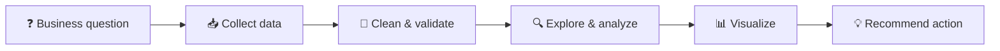

  
  
  

---

## 👋 About me

I'm a student at **Baku Engineering University** building my path into **data analytics**.
I enjoy taking messy, real-world data and turning it into clear answers: what happened, why it happened, and what to do next.

- 🔍 **What I do:** clean data, explore it, find the story, and present it in dashboards decision-makers actually use
- 🎯 **Current goal:** an internship or junior role as a Data / BI Analyst
- 🌱 **Learning now:** advanced SQL (window functions, CTEs), DAX in Power BI, and pandas for analysis
- 💬 **Ask me about:** Excel tricks, SQL queries, dashboard design

---

## 🧰 Analytics toolkit

  
  
  
  
  
  
  

| Area | What I work with |
|---|---|
| 🗄 **Data querying** | SQL — joins, aggregations, CTEs, window functions |
| 🧹 **Data cleaning** | Excel Power Query, pandas |
| 📊 **Visualization & BI** | Power BI, DAX measures, interactive dashboards |
| 🧮 **Analysis** | Descriptive statistics, KPI tracking, trend & cohort analysis |
| 🗣 **Storytelling** | Turning findings into short, actionable recommendations |

---

## 📁 Portfolio projects

> Each project follows the same structure: **business question → data → method → insights → recommendation.**

| # | Project | Business question | Tools | Status |
|:-:|---|---|---|:-:|
| 1 | 🛒 **Sales Performance Analysis** | Which products, regions and months drive revenue — and where is it leaking? | SQL · Power BI | 🚧 In progress |
| 2 | 👥 **HR Attrition Dashboard** | Why do employees leave, and who is most at risk? | Excel · Power BI | 📝 Planned |
| 3 | 🧾 **Customer Segmentation (RFM)** | Who are the most valuable customers and how should we target them? | Python · pandas | 📝 Planned |

---

## 🗺 Learning roadmap

- [x] Excel fundamentals, Pivot Tables, Power Query
- [x] SQL basics — SELECT, JOIN, GROUP BY
- [ ] Advanced SQL — CTEs, window functions, query optimization
- [ ] Power BI data modeling & DAX
- [ ] Python for analysis — pandas, matplotlib, seaborn
- [ ] Statistics for analysts — A/B testing, regression basics
- [ ] Publish 3 end-to-end portfolio projects

---

## 📈 How I approach a data problem

---

## 🤝 Let's connect

  

I'm open to **internships, junior analyst roles and collaboration on data projects**.
Feel free to reach out or star a project you find useful ⭐

